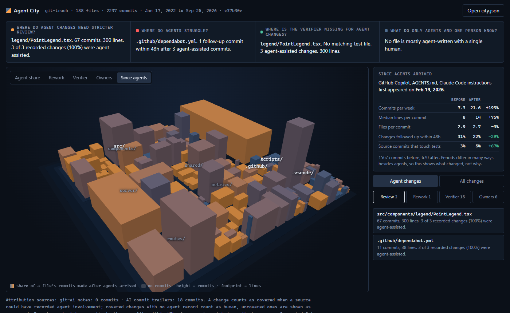

# Agent City

**See where agents write your code, and what it costs you.**

Agent City turns a git repository into a 3D city. Files are buildings, folders are districts, footprint is lines of code and height is how often a file changes. It shows where to review harder, what keeps getting reworked, where tests are missing, what only one person knows, and what changed since the team started using coding agents.

**Live demo: [agentcity.al-ex.ai](https://agentcity.al-ex.ai)**



## The Problem

Teams now ship a large share of their changes through coding agents: Claude Code, Codex, Cursor, Copilot and others. Leaders can say "AI wrote 40% of our code", but that number does not say what to do. It does not show where to review harder, where agents keep getting it wrong, where it is safe to delegate more, or where nobody understands the code anymore.

Code cities and behavioral analysis tools show hotspots and ownership but know nothing about agents. AI attribution tools record which agent wrote which lines but do not turn that into decisions.

## The Solution

Agent City joins the two. Every view answers a decision, and every number links to the commits behind it.

| Question | Signal | What you can do |
|---|---|---|
| **Where do we need stricter review?** | Large files that change often | Add owners or a second reviewer there |
| **What keeps getting reworked? Where do agents struggle?** | Commits to the same file within 48 hours of the previous one, or of an agent-assisted one | Improve the agent's context for that area, or stop delegating it |
| **Where is the verifier missing?** | Source files whose test never changes alongside them, or that have no test | Write the tests before delegating more |
| **What does only one person know?** | Files a single person changed, or that agents wrote with one human | Assign a second owner, run a walkthrough |
| **What changed since agents arrived?** | Pace, change size, follow-ups and test habits before and after the first agent instruction file | Check whether adoption improves the work or only speeds it up |

Every insight works on all changes, so a repository with no agent records still gets findings. When agent records exist, switch to **Agent changes** to see the same questions for agent-assisted work only.

## How It Works

```
repo (path or git URL)
   │
   ▼
analyzer   git history, file sizes, attribution, insights
   │
   ▼
city.json  versioned, documented format
   │
   ▼
viewer     3D city, findings, commit evidence
```

### Where agent attribution comes from

Agent City only counts what something recorded. A change with no record is shown as "no record", never as human.

| Source | Precision | Available for |
|---|---|---|
| [git-ai](https://github.com/git-ai-project/git-ai) notes (`refs/notes/ai`) | Per line | Any repository that uses git-ai |
| Claude Code transcripts (`~/.claude/projects`) | Per file edit | Local repositories on the machine where the agent ran |
| Commit trailers (`Co-Authored-By` for Claude, Copilot, Cursor, Aider, Devin and others) | Per commit | Any repository |

Without per-commit records, the first commit that added an agent instruction file (`CLAUDE.md`, `AGENTS.md`, `.cursor/`, `.github/copilot-instructions.md` and others) marks when the team started using agents, and the periods before and after are compared.

### The city

- District: a folder. Building: a file.
- Footprint: lines of code. Height: number of commits.
- Color layers: agent share, rework, verifier, owners, and share of history since agents arrived.
- Click a finding to fly to the building and read the commits behind it.

## Demos

- **[agentcity.al-ex.ai](https://agentcity.al-ex.ai)**: landing page and example cities
- **git-truck**: agent records from Copilot coding agent trailers, and a before and after comparison since the team added agent instructions
- **Express**: 5,700 commits since 2009, the all-changes view on a large, mostly human history

## Quick Start

```bash
# Prerequisites: Node 22.4+, git
npx github:al-ex-ai/AgentCity .                                   # analyze the current repository
npx github:al-ex-ai/AgentCity https://github.com/owner/repo.git   # or any git URL you can clone
```

npx installs the tool straight from this repository, no registry account needed. The analysis runs on your machine, writes `<repo>.city.json` and opens the viewer on `http://127.0.0.1`. Nothing is uploaded.

```
agent-city [repo] [options]

  -o, --out <file>        Where to write city.json (default: ./<repo>.city.json)
      --no-open           Do not open the browser
      --no-serve          Only write city.json
  -p, --port <n>          Port for the local viewer
      --since <date>      Only analyze commits after this date
  -x, --exclude <glob>    Leave matching paths out, repeatable
      --rework-hours <n>  Follow-up window for rework (default 48)
      --transcripts <dir> Claude Code transcript folder
      --no-transcripts    Do not read Claude Code transcripts
      --keep-clone        Keep the temporary clone of a URL
```

The viewer is a static site in [`viewer/`](viewer). Open any `city.json` with the button or by dropping the file, or link to one with `?city=<url>`. The analyzer and viewer share a documented, versioned format: [docs/city-format.md](docs/city-format.md).

## Limits

- It does not judge whether code is correct. Rework and missing tests are signals for a person to check, which is why every number links to its commits.
- Rework counts follow-up commits by anyone, so continuing work and fixing a mistake look the same. Read the commit messages.
- Agent edits made through shell commands are not visible in transcripts, so the agent share is a lower bound.
- Test matching uses naming conventions (`foo.test.ts`, `test_foo.py`, `foo_test.go`, `FooTest.java`, `__tests__/`).
- The before and after comparison shows what changed, not why. Periods differ in many ways besides agents.

## Tech Stack

| Tool | Purpose |
|------|---------|
| Node.js 22.4+ | Analyzer and CLI, built-in modules only, no dependencies |
| git | History, blobs and notes |
| Three.js r160 | 3D viewer, vendored, the only dependency |
| Plain ES modules | Viewer, no build step |
| node:test | Unit and end-to-end tests |

## Development

```bash
node --test                     # unit and end-to-end tests
node bin/agent-city.js .        # analyze this repository and open the viewer
node scripts/build-gallery.js   # rebuild the example gallery
```

See [VISION.md](VISION.md) for the full plan and [CHANGELOG.md](CHANGELOG.md) for releases.

## License

MIT. See [LICENSE](LICENSE). Three.js is MIT licensed, see [viewer/vendor/three/LICENSE](viewer/vendor/three/LICENSE).

## Author

Alex Husniddinov
